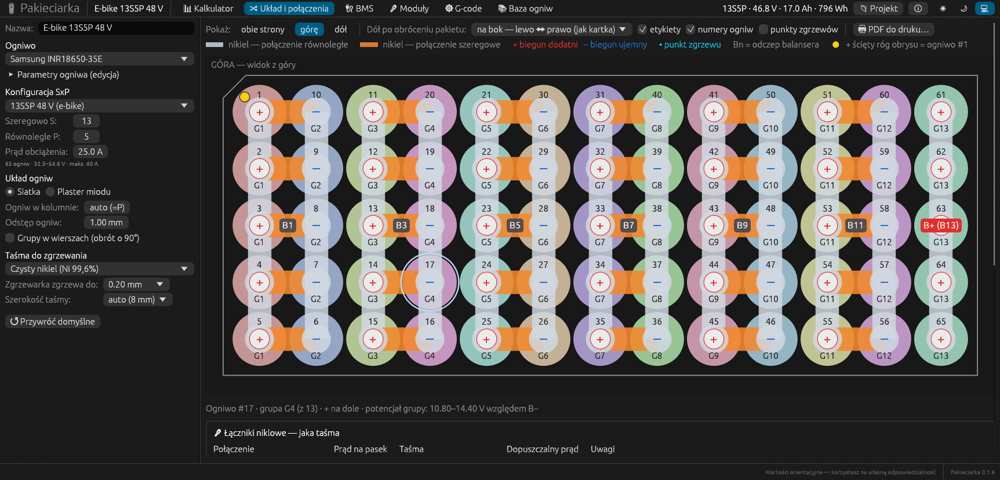
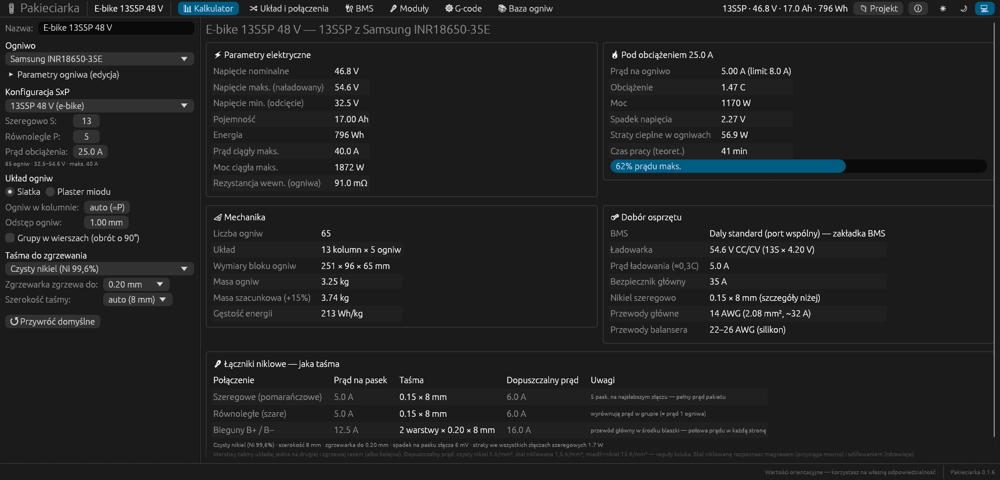
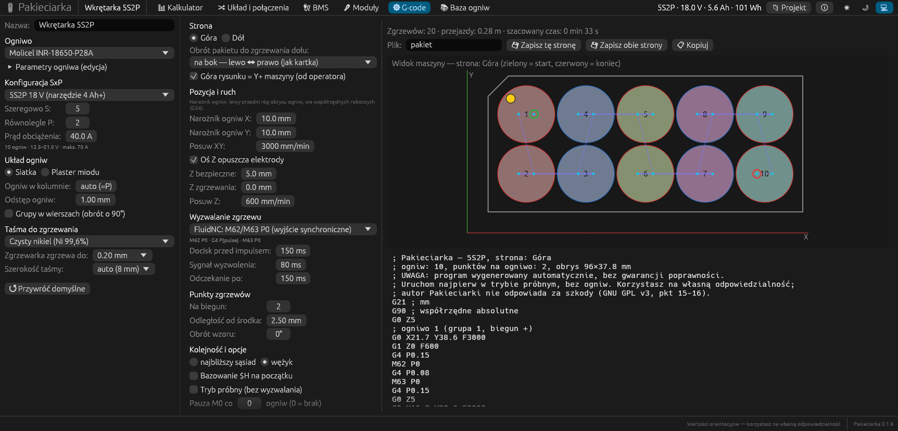
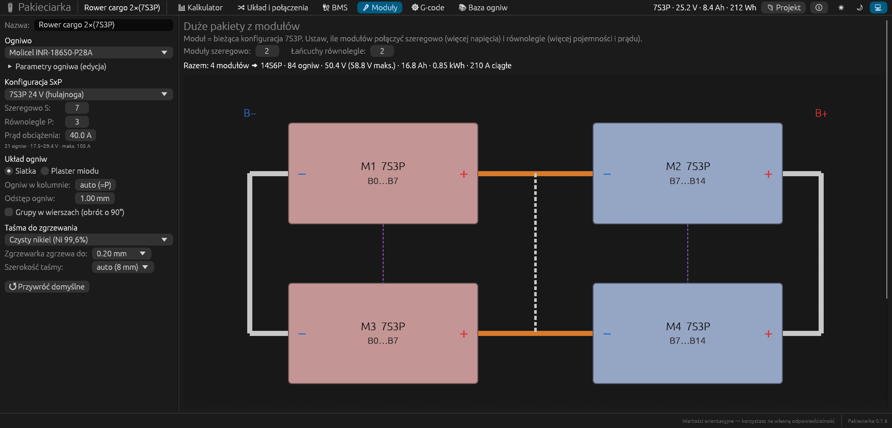
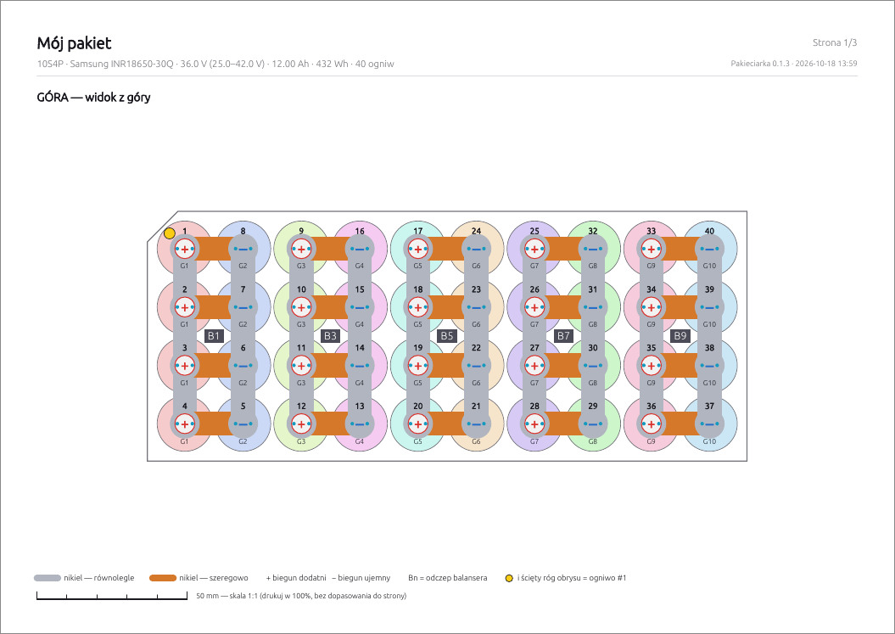

# Pakieciarka

**Konfigurator pakietów akumulatorów 18650 / 21700 z rysunkami połączeń, drukiem PDF i generatorem G-code
dla zgrzewarki (FluidNC / GRBL).**

Jeden kod w Rust ([egui](https://github.com/emilk/egui)) działa jako **natywna aplikacja na Linuksa**
(AppImage, .deb) i **macOS** (.dmg) oraz jako **aplikacja www** (WebAssembly, Docker).



📖 **[Instrukcja obsługi](docs/INSTRUKCJA.md)** — opis wszystkich funkcji ze zrzutami ekranu.

## Funkcje

- **Kalkulator** — napięcia, pojemność, energia, prądy, rezystancja; spadek napięcia, straty i czas pracy
  pod obciążeniem; wymiary i masa; dobór BMS, ładowarki, bezpiecznika, taśmy niklowej i przewodów; ostrzeżenia.
- **Gotowe pakiety** — od 1S2P do 20S6P (narzędzia, hulajnogi, e-bike, magazyny energii) albo dowolne SxP.
- **Układ i połączenia** — siatka lub plaster miodu, grupy zawijane wężykiem, polaryzacja każdego ogniwa,
  blaszki równoległe i szeregowe na górze i dole, odczepy balansera B0…BS z napięciami, numery ogniw
  i znacznik ogniwa #1 (jak „pin 1” w układach scalonych), widok dołu po obróceniu (na bok albo do siebie).
- **Łączniki niklowe** — jaka grubość i ile warstw taśmy na złącza szeregowe, równoległe i bieguny B+/B−,
  z uwzględnieniem materiału, szerokości taśmy i możliwości zgrzewarki; spadek napięcia i straty w niklu.
- **BMS** — lista BMS-ów pasujących do pakietu (Daly, JBD, JK + własne), schemat podłączenia B−/P−/C−
  z bezpiecznikiem i NTC, tabela pinów wtyczki balansera i kolejność podłączania (także w PDF).
- **PDF do druku** — góra i dół w skali 1:1 (gdy mieszczą się na A4) z linijką kontrolną, tabela odczepów
  i lista kontrolna blaszek — do ręcznego zgrzewania.
- **Moduły** — duże pakiety z modułów łączonych szeregowo i równolegle: schemat, numeracja balansera,
  instrukcja łączenia.
- **G-code** — szablony wyzwalania (FluidNC `M62/M63`, `M64/M65`, GRBL `M8/M9`, `M3/M5`, własny), oś Z,
  docisk i czasy, punkty zgrzewów na biegun, strona dolna z obrotem, tryb próbny, pauzy `M0`, podgląd ścieżki.
- **Baza ogniw** — 20 popularnych modeli + **własne ogniwa** (dodawanie, edycja, import / eksport).
- **Moje projekty** — zapisywanie (Ctrl+S), biblioteka projektów, duplikowanie, import / eksport JSON,
  ostrzeżenie o niezapisanych zmianach.

| | |
|---|---|
|  |  |
|  |  |

## Uruchomienie

### AppImage (Linux)

```sh
scripts/build-appimage.sh      # -> dist/Pakieciarka-<wersja>-x86_64.AppImage (podbija wersję)
scripts/install-local.sh       # instalacja do ~/.local/bin + wpis w menu i ikona
scripts/install-local.sh --uninstall
```

### Pakiet .deb (Debian 13, Ubuntu 24.04 i nowsze)

```sh
scripts/build-deb.sh           # -> dist/pakieciarka_<wersja>_amd64.deb (podbija wersję)
sudo apt install ./dist/pakieciarka_<wersja>_amd64.deb
sudo apt remove pakieciarka
```

Pakiet instaluje program do `/usr/bin`, wpis w menu i ikonę. Wymaga glibc ≥ 2.39.

### macOS (.dmg)

Na Macu (Apple Silicon albo Intel, macOS 11+), z zainstalowanym Rustem i Xcode Command Line Tools:

```sh
scripts/build-macos.sh         # -> dist/Pakieciarka-<wersja>-macos.dmg (binarka uniwersalna)
```

Bez Maca: workflow **GitHub Actions → macOS DMG** buduje ten sam plik na runnerze macOS — ręcznie
(„Run workflow”) albo automatycznie po wypchnięciu tagu `v*`. Gotowy `.dmg` jest w sekcji *Artifacts* przebiegu.

Aplikacja ma tylko podpis ad-hoc (bez certyfikatu Apple Developer), więc przy pierwszym uruchomieniu macOS
ostrzeże o nieznanym deweloperze — patrz [instrukcja](docs/INSTRUKCJA.md#macos--dmg).

### Oba pakiety Linuksa naraz

```sh
scripts/build-all.sh           # podbija wersję raz, buduje AppImage i .deb z tym samym numerem
```

`build-appimage.sh` i `build-deb.sh` przy każdym buildzie podbijają ostatnią cyfrę wersji w `Cargo.toml`
(`--no-bump` pomija podbicie).

### Natywnie z kodu

```sh
cargo run --release -p pakieciarka
```

Wymaga [Rust](https://rustup.rs) (stable). Na Linuksie nie są potrzebne dodatkowe biblioteki deweloperskie —
okna plików działają przez portal XDG.

### Przeglądarka

```sh
docker compose up -d --build   # http://localhost:8080
```

albo dewelopersko z przeładowaniem:

```sh
rustup target add wasm32-unknown-unknown
cargo install trunk            # lub binarka z https://github.com/trunk-rs/trunk/releases
cd app && trunk serve          # http://127.0.0.1:8080
```

## Struktura

```
core/        pakiet-core — logika bez GUI: baza ogniw i BMS, obliczenia, układ i połączenia, moduły, G-code
app/         pakieciarka — GUI (egui/eframe), natywnie i WASM
  src/app.rs       okno, zakładki, panel konfiguracji
  src/draw.rs      rysowanie pakietu, modułów i podglądu G-code
  src/library.rs   biblioteka projektów i własne ogniwa
  src/bms_ui.rs    zakładka BMS: dopasowanie, własne BMS-y, schemat podłączenia
  src/store.rs     zapis danych (pliki JSON / localStorage)
  src/pdf.rs       eksport PDF
  src/platform.rs  okna plików (portal XDG / przeglądarka)
docs/        instrukcja obsługi i zrzuty ekranu
docker/      konfiguracja nginx
scripts/     budowanie i instalacja AppImage
```

## Rozwój

```sh
cargo test                     # testy rdzenia (obliczenia, układ, G-code) i aplikacji (zapis, PDF)
```

Opcje uruchomienia przydatne przy testach i zrzutach ekranu (wersja natywna):

| Opcja | Działanie |
|---|---|
| `--tab kalk\|uklad\|bms\|moduly\|gcode\|baza\|projekty\|ogniwo` | start na zakładce / w oknie |
| `--projekt <id>` | otwiera projekt z biblioteki |
| `--widok '<json>'` | nadpisuje ustawienia widoku, np. `'{"sides":"Bottom","show_spots":true}'` |
| `--rozmiar 1500x950` | rozmiar okna |
| `plik.json` | import projektu |
| `PAKIECIARKA_SCREENSHOT=plik.ppm` | zapisuje zrzut okna i kończy program |
| `PAKIECIARKA_SCROLL=px` | przewinięcie zakładki BMS (do zrzutów) |
| `XDG_DATA_HOME=katalog` | osobny katalog danych (nie rusza Twoich projektów) |

### Konwencje

- Współrzędne układu: widok z góry, mm, początek w lewym górnym rogu obrysu ogniw.
- Grupa G1 ma `+` na górze, kolejne grupy są naprzemiennie odwrócone; złącza szeregowe wypadają naprzemiennie
  na górze (G1–G2, G3–G4…) i na dole (G2–G3…).
- G-code: domyślnie góra rysunku = Y+ maszyny (od operatora); „Narożnik ogniw X/Y” to lewy-przedni róg obrysu
  ogniw we współrzędnych roboczych (G54). Dół: pakiet obrócony na bok (lustro X) albo do siebie (lustro Y).

## Plany

- Wysyłanie G-code do FluidNC / GRBL przez port szeregowy (jog, bazowanie, zgrzew testowy).
- Druk dużych pakietów w skali 1:1 na kilku kartkach A4.
- Ręczna edycja układu ogniw (kształty pod konkretną obudowę).

## Licencja

Copyright © 2026 Cyryl Sochacki

Pakieciarka jest wolnym oprogramowaniem na licencji **[GNU GPL v3.0 lub nowszej](LICENSE)** (`GPL-3.0-or-later`).
Możesz ją używać, kopiować, zmieniać i rozpowszechniać, ale każda rozpowszechniana wersja — także zmieniona
i także udostępniana jako aplikacja www — musi pozostać otwarta, na tej samej licencji, razem z kodem źródłowym.

Interfejs i PDF korzystają z czcionek dołączonych do egui (Ubuntu Font Licence, OFL).

## Zastrzeżenia

> **Pakieciarka jest narzędziem pomocniczym.** Wszystkie wartości (prądy, dobór taśmy, przewodów, BMS, bezpieczników,
> masy, wymiary) są wyliczane z uproszczonych modeli i reguł kciuka; rysunki, PDF i G-code mogą zawierać błędy.
> Budowa i użytkowanie akumulatorów litowych grozi pożarem, wybuchem i porażeniem; powyżej 60 V DC napięcie jest
> niebezpieczne dla życia. Program jest dostarczany „tak jak jest”, **bez jakiejkolwiek gwarancji** (GNU GPL v3,
> pkt 15–16) — autor nie ponosi odpowiedzialności za szkody wynikłe z jego użycia. **Korzystasz na własną
> odpowiedzialność.** Pełna treść: [instrukcja, rozdział 14](docs/INSTRUKCJA.md#14-bezpieczeństwo-i-zastrzeżenia).
