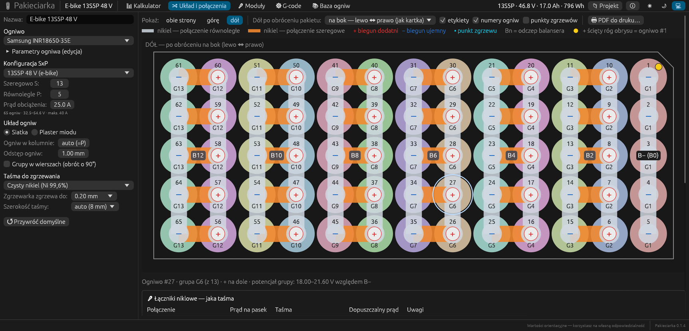
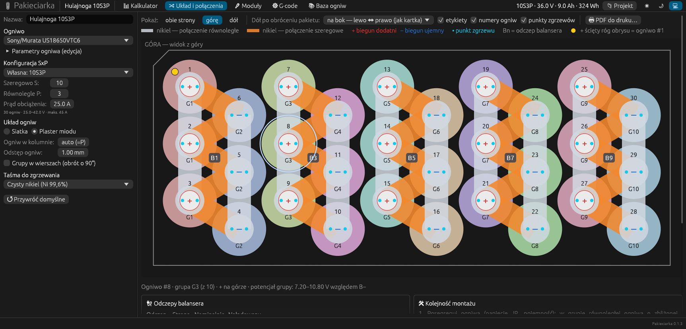
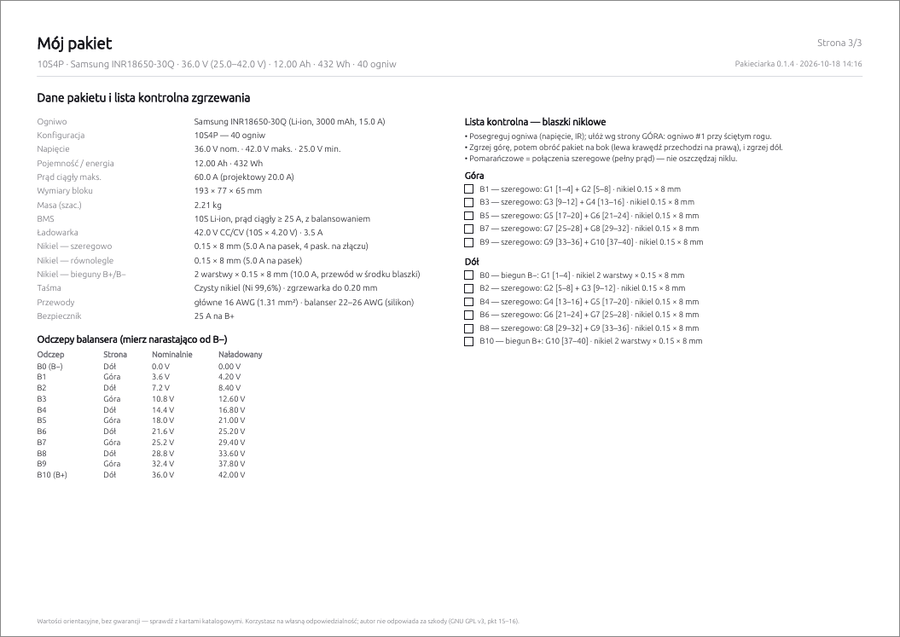
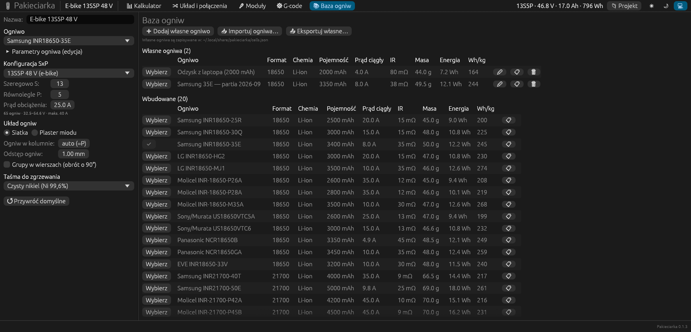
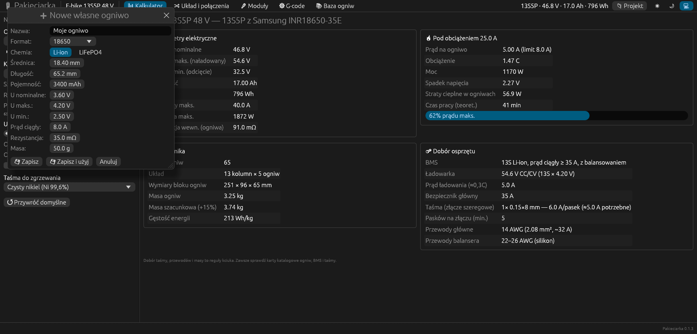
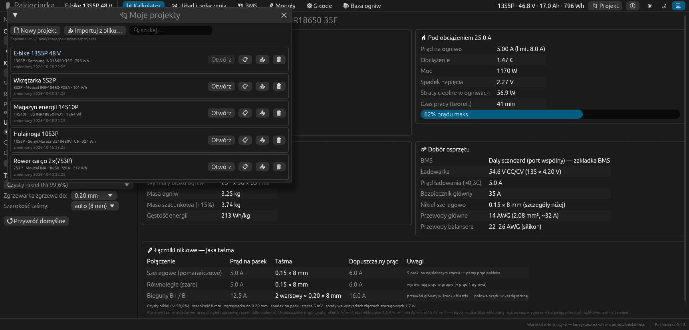
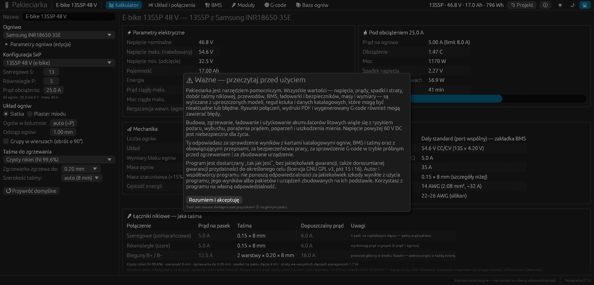

# Pakieciarka — instrukcja obsługi

Pakieciarka pomaga zaprojektować pakiet akumulatorów z ogniw cylindrycznych (głównie 18650, także 21700, 26650, 32700),
pokazuje, jak połączyć ogniwa niklem, drukuje rysunki do ręcznego zgrzewania i generuje G-code dla zgrzewarki
sterowanej przez FluidNC / GRBL.

## Spis treści

1. [Instalacja i uruchomienie](#1-instalacja-i-uruchomienie)
2. [Okno programu](#2-okno-programu)
3. [Panel konfiguracji (po lewej)](#3-panel-konfiguracji-po-lewej)
4. [Kalkulator](#4-kalkulator)
5. [Układ i połączenia](#5-układ-i-połączenia)
6. [Druk PDF do ręcznego zgrzewania](#6-druk-pdf-do-ręcznego-zgrzewania)
7. [Moduły — duże pakiety](#7-moduły--duże-pakiety)
8. [G-code dla zgrzewarki](#8-g-code-dla-zgrzewarki)
9. [Baza ogniw i własne ogniwa](#9-baza-ogniw-i-własne-ogniwa)
10. [Moje projekty — zapisywanie i otwieranie](#10-moje-projekty--zapisywanie-i-otwieranie)
11. [Skróty klawiszowe i opcje uruchomienia](#11-skróty-klawiszowe-i-opcje-uruchomienia)
12. [Gdzie program trzyma dane](#12-gdzie-program-trzyma-dane)
13. [Bezpieczeństwo i zastrzeżenia](#13-bezpieczeństwo-i-zastrzeżenia)
14. [Najczęstsze pytania](#14-najczęstsze-pytania)

---

## 1. Instalacja i uruchomienie

### Linux — AppImage (zalecane)

AppImage to jeden plik, który działa bez instalacji.

```sh
chmod +x Pakieciarka-*-x86_64.AppImage
./Pakieciarka-*-x86_64.AppImage
```

Żeby program pojawił się w menu aplikacji (z ikoną), w katalogu z kodem źródłowym uruchom:

```sh
scripts/install-local.sh            # instaluje najnowszy AppImage z dist/ do ~/.local/bin
scripts/install-local.sh --uninstall
```

### Linux — pakiet .deb (Debian 13, Ubuntu 24.04 i nowsze)

```sh
sudo apt install ./pakieciarka_*_amd64.deb     # instalacja (program trafia do menu aplikacji)
sudo apt remove pakieciarka                    # odinstalowanie
```

Po instalacji Pakieciarka jest w menu aplikacji (Elektronika / Programowanie) i jako polecenie `pakieciarka`.
Twoje projekty w `~/.local/share/pakieciarka` zostają przy odinstalowaniu i aktualizacji.

### macOS — .dmg

1. Otwórz `Pakieciarka-<wersja>-macos.dmg` i przeciągnij **Pakieciarka** do folderu **Aplikacje**.
2. Pierwsze uruchomienie: aplikacja nie ma certyfikatu Apple Developer, więc macOS ją zablokuje
   („nie można zweryfikować dewelopera”). W Finderze kliknij ją **prawym przyciskiem → Otwórz → Otwórz**
   (na macOS 15: *Ustawienia systemowe → Prywatność i ochrona → Otwórz mimo to*). Kolejne uruchomienia działają
   normalnie.

   Alternatywnie w Terminalu: `xattr -dr com.apple.quarantine /Applications/Pakieciarka.app`

Działa na Macach z Apple Silicon i Intel, macOS 11 lub nowszy. Skróty klawiszowe używają **⌘** zamiast Ctrl.

### Przeglądarka

Pakieciarka działa też jako strona www (WebAssembly) — obliczenia wykonują się w przeglądarce, serwer tylko
udostępnia pliki. Uruchomienie w Dockerze:

```sh
docker compose up -d --build        # http://localhost:8080
```

Różnice wersji www: projekty i własne ogniwa trafiają do pamięci przeglądarki (localStorage), pliki zapisuje się
przez pobieranie, a wczytuje przez okno wyboru pliku.

### Z kodu źródłowego

```sh
cargo run --release -p pakieciarka
```

Szczegóły budowania są w [README](../README.md).

### Pierwsze uruchomienie

Przy pierwszym uruchomieniu program pokazuje okno **„Ważne — przeczytaj przed użyciem”** z zastrzeżeniami
(wyniki są orientacyjne, program jest bez gwarancji, korzystasz na własną odpowiedzialność). Pracę można zacząć
po kliknięciu **Rozumiem i akceptuję**. Treść jest potem zawsze dostępna pod przyciskiem **ℹ** na górnym pasku —
patrz [rozdział 13](#13-bezpieczeństwo-i-zastrzeżenia).

---

## 2. Okno programu


| Miejsce | Co zawiera |
|---|---|
| **Górny pasek** | nazwa projektu (z dopiskiem **• niezapisany**, gdy są zmiany), zakładki, podsumowanie pakietu (np. `13S5P · 46.8 V · 17.0 Ah · 796 Wh`), przycisk **Zapisz** (gdy są zmiany), menu **📁 Projekt**, **ℹ** — o programie i zastrzeżenia, wybór motywu (jasny / ciemny / systemowy) |
| **Panel po lewej** | ogniwo, konfiguracja SxP, prąd obciążenia, układ ogniw i rodzaj taśmy — wspólne dla wszystkich zakładek |
| **Środek** | zawartość wybranej zakładki |
| **Pasek stanu (dół)** | komunikaty (np. „zapisano …”), przypomnienie, że wartości są orientacyjne, numer wersji programu |

Zakładki:

- **📊 Kalkulator** — parametry elektryczne, obciążenie, mechanika, dobór osprzętu.
- **🔀 Układ i połączenia** — rysunek pakietu z góry i z dołu, blaszki niklowe, odczepy balansera, druk PDF.
- **🔗 Moduły** — łączenie gotowych modułów w duży pakiet.
- **⚙ G-code** — program dla zgrzewarki CNC.
- **📚 Baza ogniw** — wbudowane i własne ogniwa.

Program na bieżąco pamięta stan pracy — po zamknięciu i ponownym otwarciu zobaczysz to samo, nawet bez zapisywania.
Żeby mieć projekt na stałe (i móc wrócić do niego później), zapisz go w **Moich projektach** (Ctrl+S).

---

## 3. Panel konfiguracji (po lewej)

| Pole | Opis |
|---|---|
| **Nazwa** | nazwa projektu — pojawia się w tytule okna, w bibliotece projektów, w nazwach plików i na wydruku |
| **Ogniwo** | wybór z bazy. Własne ogniwa są w osobnej sekcji „Własne” i oznaczone ★ |
| **Parametry ogniwa (edycja)** | szybka zmiana parametrów ogniwa tylko w tym projekcie. Przycisk **★ Zapisz jako własne ogniwo** dodaje je do bazy |
| **Konfiguracja SxP** | gotowe pakiety (np. *13S5P 48 V (e-bike)*). Po wybraniu lista pokazuje nazwę presetu; przy własnych wartościach — np. *Własna: 11S3P* |
| **Szeregowo S** | liczba grup połączonych szeregowo (1–40) — decyduje o napięciu |
| **Równolegle P** | liczba ogniw w grupie (1–40) — decyduje o pojemności i prądzie |
| **Prąd obciążenia** | projektowy prąd ciągły pakietu [A] — na jego podstawie liczone są spadki napięcia, straty i dobór osprzętu |
| **Układ ogniw** | **Siatka** (prostokątna) albo **Plaster miodu** (gęstszy, kolumny przesunięte o pół ogniwa) |
| **Ogniw w kolumnie** | `auto (=P)` — każda grupa to jedna kolumna. Większa wartość „zawija” grupy wężykiem — pakiet robi się krótszy i szerszy |
| **Odstęp ogniw** | szczelina między ogniwami (koszyki, separatory) [mm] — wpływa na wymiary, rysunek i G-code |
| **Grupy w wierszach** | obraca układ o 90° (grupy poziomo zamiast pionowo) |
| **Taśma do zgrzewania** | czysty nikiel, stal niklowana albo kanapka miedź + nikiel — wpływa na dobór grubości taśmy |
| **Zgrzewarka zgrzewa do** | najgrubsza taśma, którą Twoja zgrzewarka pewnie zgrzewa (0,10–0,30 mm). Program nie zaproponuje grubszej — zamiast tego doda warstwy |
| **Szerokość taśmy** | `auto` dobiera szerokość do ogniwa (18650 → 8 mm, 21700 → 10 mm), można wybrać 6–12 mm |
| **Przywróć domyślne** | przywraca domyślne ustawienia (nazwa projektu zostaje) |

---

## 4. Kalkulator

Zakładka zbiera wszystkie wyliczenia dla bieżącej konfiguracji (zrzut w rozdziale 2).

**⚡ Parametry elektryczne**

| Wartość | Jak liczona |
|---|---|
| Napięcie nominalne / maks. / min. | S × napięcie ogniwa (nominalne, naładowane, odcięcia) |
| Pojemność | P × pojemność ogniwa |
| Energia | napięcie nominalne × pojemność |
| Prąd ciągły maks. | P × prąd ciągły ogniwa |
| Moc ciągła maks. | napięcie nominalne × prąd ciągły maks. |
| Rezystancja wewn. | S × IR ogniwa ÷ P (bez połączeń niklowych) |

**🔥 Pod obciążeniem** (dla prądu z panelu po lewej): prąd na jedno ogniwo i limit, obciążenie w C, moc, spadek
napięcia, straty cieplne w ogniwach, teoretyczny czas pracy oraz pasek wykorzystania prądu maksymalnego.

**📐 Mechanika**: liczba ogniw, układ (kolumny × ogniwa), wymiary bloku ogniw (bez obudowy), masa ogniw,
masa szacunkowa (+15% na nikiel, BMS, przewody, obudowę) i gęstość energii.

**🔩 Dobór osprzętu**

| Pozycja | Reguła |
|---|---|
| BMS | S, chemia, prąd ciągły ≥ 1,25 × prąd obciążenia (zaokrąglony w górę do 5 A) |
| Ładowarka | napięcie S × U maks. ogniwa, tryb CC/CV |
| Prąd ładowania | ≈ 0,3 C |
| Bezpiecznik główny | jak prąd BMS |
| Nikiel szeregowo | skrót — szczegóły w karcie **Łączniki niklowe** poniżej |
| Przewody główne | AWG z tabeli dla przewodu silikonowego, krótki odcinek |
| Przewody balansera | 22–26 AWG |

**🔗 Łączniki niklowe — jaka taśma**

Karta mówi, jakiej grubości (i ile warstw) taśmy użyć dla każdego rodzaju połączenia — przy wybranym materiale,
szerokości taśmy i możliwościach zgrzewarki (panel po lewej). Ta sama karta jest w zakładce *Układ i połączenia*.

| Połączenie | Prąd na pasek | Dlaczego |
|---|---|---|
| **Szeregowe** (pomarańczowe na rysunku) | prąd obciążenia ÷ liczba pasków na najsłabszym złączu grup | przez złącza szeregowe płynie cały prąd pakietu, dzielony na paski między grupami |
| **Równoległe** (szare) | prąd jednego ogniwa (prąd obciążenia ÷ P) | w pracy wyrównują prąd w grupie; projektowane na prąd ogniwa na wypadek nierównych ogniw albo słabszego zgrzewu |
| **Bieguny B+ / B−** | połowa prądu obciążenia | blaszka zbiera cały prąd do przewodu głównego — przy przewodzie przylutowanym w środku blaszki płynie po połowie w każdą stronę |

Dla każdego połączenia program podaje taśmę, np. `0.15 × 8 mm` albo `2 warstwy × 0.20 × 8 mm`, i jej dopuszczalny
prąd. Dobór: najpierw jedna warstwa najcieńszej wystarczającej taśmy, a gdy przekroczyłaby możliwości zgrzewarki —
kilka warstw. Dopuszczalna gęstość prądu (reguła kciuka): czysty nikiel 5 A/mm², stal niklowana 1,5 A/mm²,
miedź + nikiel 15 A/mm². Czerwona wartość oznacza, że nawet 4 warstwy nie wystarczą.

Pod tabelą: spadek napięcia na jednym pasku złącza szeregowego i straty ciepła we wszystkich złączach
szeregowych (liczone dla odcinka między środkami ogniw).

> Warstwy taśmy układaj jedna na drugiej i zgrzewaj razem albo kolejno. Stal niklowaną rozpoznasz magnesem
> (przyciąga mocno) i po szlifowaniu (rdzewieje) — nie nadaje się do większych prądów.

**Ostrzeżenia** (żółte ramki) pojawiają się, gdy: obciążenie przekracza prąd maksymalny pakietu, obciążenie jest
większe niż 3 C, spadek napięcia przekracza 10%, wybrano stal niklowaną, napięcie maksymalne przekracza 60 V DC,
złącze szeregowe ma za mało pasków niklu (układ z wysokością kolumny ≠ P), taśma w zasięgu zgrzewarki nie przeniesie
prądu złącza szeregowego, albo bieguny B+/B− wymagają więcej niż 2 warstw (wtedy lepiej przylutować przewód wzdłuż
blaszki albo użyć miedzianej szyny).

> Dobór taśmy, przewodów i masy to reguły kciuka. Zawsze sprawdź karty katalogowe ogniw, BMS i taśmy.

---

## 5. Układ i połączenia


### Co widać na rysunku

| Element | Znaczenie |
|---|---|
| Kolorowe koła | ogniwa; jeden kolor = jedna grupa równoległa (G1, G2, …) |
| **Liczba nad biegunem** | numer ogniwa #1…#N — ten sam na górze i na dole |
| **G1, G2…** pod biegunem | numer grupy |
| ⊕ czerwony | biegun dodatni na tej stronie |
| − niebieski | biegun ujemny na tej stronie |
| Szary pasek | nikiel — połączenie **równoległe** (w obrębie grupy) |
| Pomarańczowy pasek | nikiel — połączenie **szeregowe** (między grupami) — płynie przez nie pełny prąd pakietu |
| **B1, B3…** | odczepy balansera (BMS). **B− (B0)** — minus pakietu, **B+ (BS)** — plus pakietu |
| Żółta kropka + ścięty róg obrysu | **ogniwo #1** — jak „pin 1” w układach scalonych; pozwala się zorientować po obróceniu pakietu |
| Niebieskie kropki | punkty zgrzewów (opcja „punkty zgrzewów”) |

Ogniwa są numerowane kolumnami „wężykiem” (kolumna w dół, następna w górę…), a kolejne grupy po P ogniw są
wycinane z tej ścieżki. Grupa G1 ma plus na górze, każda następna jest odwrócona — dzięki temu połączenia
szeregowe wypadają naprzemiennie na górze (G1–G2, G3–G4…) i na dole (G2–G3, G4–G5…).

### Pasek opcji

- **Pokaż: obie strony / górę / dół** — który widok rysować.
- **Dół po obróceniu pakietu** — jak obracasz pakiet, żeby zgrzać dół:
  - *na bok — lewo ↔ prawo (jak kartka)* — obrót wokół osi pionowej; ogniwo #1 przechodzi z lewej na prawą,
  - *do siebie — przód ↔ tył* — obrót wokół osi poziomej; ogniwo #1 przechodzi z góry rysunku na dół.

  Widok dołu zawsze pokazuje pakiet dokładnie tak, jak zobaczysz go po obróceniu. To samo ustawienie używa G-code.
- **etykiety** — grupy i odczepy balansera, **numery ogniw**, **punkty zgrzewów** — co dorysować.
- **🖶 PDF do druku…** — patrz [rozdział 6](#6-druk-pdf-do-ręcznego-zgrzewania).



Najechanie kursorem na ogniwo pokazuje pod rysunkiem: numer, grupę, po której stronie jest plus oraz potencjał
grupy względem B−.



### Pod rysunkiem

- **🔗 Łączniki niklowe** — ta sama karta co w Kalkulatorze: jaka taśma na złącza szeregowe, równoległe i bieguny.
- **🔌 Odczepy balansera** — tabela B0…BS: strona pakietu, napięcie nominalne i po naładowaniu (narastająco od B−).
  Przed podłączeniem BMS zmierz miernikiem napięcia kolejnych odczepów względem B− i porównaj z tabelą.
- **🛠 Kolejność montażu** — skrócona instrukcja składania pakietu.

---

## 6. Druk PDF do ręcznego zgrzewania

Przycisk **🖶 PDF do druku…** w zakładce *Układ i połączenia* tworzy dokument A4 (poziomo):

1. **GÓRA** — rysunek połączeń,
2. **DÓŁ** — rysunek po obróceniu (z opisem, jak obrócić pakiet),
3. **Dane pakietu i lista kontrolna** — parametry, dobór osprzętu (osobno nikiel szeregowo, równolegle i na
   bieguny), tabela odczepów balansera i lista blaszek do odhaczania — przy każdej blaszce jest podana taśma.

Na dole każdej strony jest krótkie zastrzeżenie (wartości orientacyjne, bez gwarancji).


- Jeśli pakiet mieści się na A4, rysunek jest w **skali 1:1** — możesz układać ogniwa na wydruku albo przycinać
  nikiel na wzór. Większe pakiety są zmniejszane, a skala jest podana przy linijce.
- Pod rysunkiem jest **linijka kontrolna 50 mm**. Po wydruku zmierz ją — jeśli nie ma 50 mm, drukarka przeskalowała
  stronę. Drukuj w **100% / „rozmiar rzeczywisty”**, bez „dopasuj do strony”.
- Opcje *etykiety*, *numery ogniw* i *punkty zgrzewów* z paska działają też w PDF.



Lista kontrolna wypisuje każdą blaszkę, np. `☐ B3 — szeregowo: G3 [9–12] + G4 [13–16] · nikiel 0.15 × 8 mm` —
które grupy łączy, które ogniwa (numery) obejmuje i jaką taśmą ją zgrzać. Przy ręcznym zgrzewaniu odhaczaj kolejne blaszki.

W wersji natywnej PDF po zapisaniu otwiera się od razu w domyślnej przeglądarce PDF (stąd drukujesz);
w wersji www plik jest pobierany.

---

## 7. Moduły — duże pakiety


Moduł to bieżąca konfiguracja z panelu po lewej. Ustaw:

- **Moduły szeregowo** (1–12) — więcej napięcia,
- **Łańcuchy równolegle** (1–8) — więcej pojemności i prądu.

Nad schematem jest podsumowanie całego pakietu (np. *4 modułów ➡ 14S6P · 84 ogniw · 50.4 V …*).

Na schemacie:

- pomarańczowe linie — połączenia **szeregowe** (+ modułu z − następnego),
- szare szyny — wspólne **B−** i **B+** łańcuchów równoległych,
- przerywane linie — łączenie węzłów i **balansera** między modułami równoległymi,
- **B0…B7, B7…B14** — zakres odczepów balansera całego pakietu przypadający na moduł.

Pod schematem jest instrukcja **Jak połączyć** krok po kroku (wyrównanie napięć, łączenie równoległe razem
z odczepami balansera, jeden BMS na cały pakiet, numeracja odczepów, bezpiecznik). Powyżej 60 V DC program
wyświetla ostrzeżenie.

---

## 8. G-code dla zgrzewarki


Po lewej są ustawienia, po prawej podsumowanie (liczba zgrzewów, długość przejazdów, szacowany czas), podgląd
ścieżki we współrzędnych maszyny (zielony okrąg = start, czerwony = koniec) i treść programu.

### Ustawienia

**Strona**

| Pole | Opis |
|---|---|
| Góra / Dół | dla której strony generować program |
| Obrót pakietu do zgrzewania dołu | to samo ustawienie co w zakładce *Układ* (na bok / do siebie) |
| Góra rysunku = Y+ maszyny (od operatora) | zaznaczone (domyślnie): kładziesz pakiet na stole tak, jak wygląda na ekranie, a Y+ maszyny rośnie od operatora. Odznacz, jeśli w Twojej maszynie Y+ rośnie w stronę operatora |

**Pozycja i ruch**

| Pole | Opis |
|---|---|
| Narożnik ogniw X / Y | gdzie na stole leży **lewy-przedni róg obrysu ogniw** (nie koszyka, nie środek ogniwa). Wartości są we **współrzędnych roboczych** (G54) — względem zera, które ustawisz w sterowniku, a nie zera maszyny. Dla dołu — róg pakietu już po obróceniu |
| Posuw XY | prędkość przejazdów [mm/min] |
| Oś Z opuszcza elektrody | odznacz, jeśli głowica nie ma osi Z (np. siłownik sterowany wyjściem) |
| Z bezpieczne / Z zgrzewania | wysokości przejazdu i zgrzewu — też we współrzędnych roboczych |
| Posuw Z | prędkość opuszczania elektrod |

> Praktycznie: przykręć do stołu kątownik, dosuwaj do niego pakiet i wpisz współrzędne narożnika kątownika.
> Albo najedź elektrodą na róg obrysu ogniw, ustaw tam zero robocze X/Y i wpisz 0 / 0.

**Wyzwalanie zgrzewu**

| Opcja | Polecenia |
|---|---|
| FluidNC: M62/M63 P0 (wyjście synchroniczne) | `M62 P0` · `G4 P{pulse}` · `M63 P0` |
| FluidNC: M64/M65 P0 (wyjście natychmiastowe) | `G4 P0` · `M64 P0` · `G4 P{pulse}` · `M65 P0` |
| GRBL: M8/M9 (wyjście chłodzenia) | `M8` · `G4 P{pulse}` · `M9` |
| M3/M5 (wyjście wrzeciona / PWM) | `M3 S1000` · `G4 P{pulse}` · `M5` |
| Własny szablon | dowolne linie; zmienne: `{pulse}` — czas sygnału [s], `{n}` — numer zgrzewu, `{cell}` — numer ogniwa |

Sygnał wyzwolenia zwykle podaje się na wejście „pedału” zgrzewarki — czas i energię impulsu ustawia sama zgrzewarka.

| Pole | Opis |
|---|---|
| Docisk przed impulsem | odczekanie po opuszczeniu elektrod [ms] |
| Sygnał wyzwolenia | czas trwania sygnału [ms] (`{pulse}`) |
| Odczekanie po | pauza po zgrzewie, przed podniesieniem elektrod [ms] |

**Punkty zgrzewów**: liczba punktów na biegun (1–8), odległość od środka bieguna [mm] i obrót wzoru [°].
Punkty widać na rysunku w zakładce *Układ* po zaznaczeniu „punkty zgrzewów”.

**Kolejność i opcje**

| Pole | Opis |
|---|---|
| wężyk / najbliższy sąsiad | kolejność ogniw: w porządku numeracji albo zawsze do najbliższego ogniwa |
| Bazowanie $H na początku | dodaje `$H` przed programem |
| Tryb próbny (bez wyzwalania) | polecenia wyzwalania stają się komentarzami — maszyna tylko jeździ |
| Pauza M0 co N ogniw | zatrzymanie programu (np. kontrola i czyszczenie elektrod); 0 = bez pauz |
| Własny nagłówek / stopka | dodatkowe linie na początku i końcu programu |
| Domyślne ustawienia G-code | przywraca ustawienia fabryczne tej zakładki |

### Zapisywanie programu

- **Plik** — początek nazwy pliku; program dopisuje `_gora.gcode` albo `_dol.gcode`.
- **Zapisz tę stronę** / **Zapisz obie strony** — zapis przez okno wyboru pliku (w www: pobranie).
- **Kopiuj** — program trafia do schowka.

### Budowa programu

```gcode
; Pakieciarka — 5S2P, strona: Góra
; UWAGA: program wygenerowany automatycznie, bez gwarancji poprawności. (…)
G21 ; mm
G90 ; współrzędne absolutne
G0 Z5
; ogniwo 1 (grupa 1, biegun +)
G0 X21.7 Y38.6 F3000      ; dojazd nad punkt zgrzewu
G1 Z0 F600                ; opuszczenie elektrod
G4 P0.15                  ; docisk
M62 P0                    ; wyzwolenie (szablon)
G4 P0.08
M63 P0
G4 P0.15                  ; odczekanie po zgrzewie
G0 Z5                     ; podniesienie
...
G0 X10 Y10                ; powrót nad narożnik
M2
```

> Pierwsze uruchomienie zawsze w **trybie próbnym** i bez ogniw. Sprawdź, czy elektrody trafiają w środki biegunów.

---

## 9. Baza ogniw i własne ogniwa



Tabela pokazuje dla każdego ogniwa: format, chemię, pojemność, prąd ciągły, rezystancję wewnętrzną, masę, energię
i gęstość energii (Wh/kg). **Wybierz** ustawia ogniwo w bieżącym projekcie (✔ = wybrane).

**Własne ogniwa**

| Przycisk | Działanie |
|---|---|
| ➕ Dodaj własne ogniwo | nowe ogniwo (startuje z parametrów bieżącego) |
| ✏ | edycja własnego ogniwa |
| 📋 (przy własnym) | duplikat do edycji |
| 📋 (przy wbudowanym) | kopia wbudowanego do własnych — np. żeby wpisać parametry zmierzone dla Twojej partii |
| 🗑 | usunięcie — kliknij drugi raz („Usunąć?”), żeby potwierdzić |
| 📥 Importuj ogniwa… / 📤 Eksportuj własne… | wymiana bazy z innymi (plik JSON) |



W oknie edycji zmiana **formatu** ustawia jego średnicę i długość, a zmiana **chemii** — typowe napięcia
(Li-ion 3,6 / 4,2 / 2,5 V, LiFePO4 3,2 / 3,65 / 2,5 V). **Zapisz i użyj** od razu wybiera ogniwo w projekcie.

Program sprawdza, czy: nazwa nie jest pusta i nie powtarza się (także z wbudowanymi), napięcia spełniają
min < nominalne < maks., a pojemność, prąd i średnica są dodatnie.

Import przyjmuje listę ogniw albo pojedyncze ogniwo w JSON; ogniwo o tej samej nazwie jest zastępowane.

---

## 10. Moje projekty — zapisywanie i otwieranie

Menu **📁 Projekt**:

| Pozycja | Działanie |
|---|---|
| 🗋 Nowy (Ctrl+N) | nowy projekt z ustawieniami domyślnymi |
| 📂 Moje projekty… (Ctrl+O) | okno biblioteki projektów |
| 💾 Zapisz (Ctrl+S) | zapisuje projekt w bibliotece (pierwszy zapis tworzy nową pozycję) |
| 💾 Zapisz jako nowy | zapisuje kopię jako osobny projekt |
| 📤 Eksportuj do pliku… | zapis projektu do pliku JSON (np. do przesłania) |
| 📥 Importuj z pliku… | wczytanie projektu z pliku JSON |
| { } JSON (schowek)… | podgląd projektu jako JSON — kopiowanie / wklejanie |



W oknie **Moje projekty** każdy projekt ma skrót (konfiguracja, ogniwo, energia) i datę zmiany. Przyciski:
**Otwórz**, **📋 Duplikuj**, **📤 Eksportuj**, **🗑 Usuń** (z potwierdzeniem). Pole **szukaj** filtruje po nazwie
projektu i ogniwa. Otwarty projekt jest podświetlony.

**Niezapisane zmiany** — przy nazwie projektu pojawia się **• niezapisany**, a w tytule okna `●`. Gdy otwierasz
inny projekt albo tworzysz nowy, program zapyta: **Zapisz i kontynuuj**, **Odrzuć zmiany** albo **Anuluj**.

Zaimportowany projekt nie trafia od razu do biblioteki — zapisz go (Ctrl+S), żeby się tam znalazł.
Plik `.json` można też otworzyć z menedżera plików („Otwórz za pomocą → Pakieciarka”).

---

## 11. Skróty klawiszowe i opcje uruchomienia

| Skrót | Działanie |
|---|---|
| Ctrl+S (⌘S na macOS) | zapisz projekt |
| Ctrl+O (⌘O) | Moje projekty |
| Ctrl+N (⌘N) | nowy projekt |

Opcje wiersza poleceń (wersja natywna):

| Opcja | Działanie |
|---|---|
| `plik.json` | importuje projekt z pliku |
| `--tab kalk\|uklad\|moduly\|gcode\|baza\|projekty` | otwiera wybraną zakładkę (lub okno projektów) |
| `--projekt <id>` | otwiera projekt z biblioteki (id = nazwa pliku w katalogu projektów, bez `.json`) |
| `--rozmiar 1500x950` | rozmiar okna |

---

## 12. Gdzie program trzyma dane

| Dane | Linux | macOS | Przeglądarka |
|---|---|---|---|
| Projekty | `~/.local/share/pakieciarka/projects/*.json` | `~/Library/Application Support/pakieciarka/projects/*.json` | localStorage |
| Własne ogniwa | `~/.local/share/pakieciarka/cells.json` | `~/Library/Application Support/pakieciarka/cells.json` | localStorage |
| Bieżący stan pracy i ustawienia widoku | `~/.local/share/pakieciarka/app.ron` | `~/Library/Application Support/pakieciarka/app.ron` | localStorage |

Projekty to zwykłe pliki JSON — kopia zapasowa to skopiowanie katalogu danych (tabela powyżej).
Jeśli ustawiona jest zmienna `XDG_DATA_HOME`, katalog jest w `$XDG_DATA_HOME/pakieciarka`.

---

## 13. Bezpieczeństwo i zastrzeżenia

- Ogniwa litowe zwarte niklem lub narzędziem mogą się zapalić. Pracuj na niepalnym podłożu, miej pod ręką koc
  gaśniczy / piasek, izoluj bieguny, których akurat nie zgrzewasz.
- Powyżej **60 V DC** napięcie jest niebezpieczne dla człowieka — program ostrzega o tym w Kalkulatorze i Modułach.
- Przed połączeniem równoległym wyrównaj napięcia ogniw / modułów (różnica ≤ 0,05 V).
- Przed podłączeniem BMS zmierz napięcia odczepów narastająco od B− i porównaj z tabelą odczepów.
- Bezpiecznik główny montuj na B+, możliwie blisko pakietu.
- Wygenerowany G-code uruchamiaj najpierw w **trybie próbnym**, bez ogniw.
- Wyliczenia programu to pomoc projektowa, nie gwarancja — weryfikuj je z kartami katalogowymi.

### Zastrzeżenia

Tę treść program pokazuje przy pierwszym uruchomieniu (do akceptacji) i pod przyciskiem **ℹ**; skrót jest na pasku
stanu, w stopce PDF i w nagłówku G-code.



> Pakieciarka jest narzędziem pomocniczym. Wszystkie wartości — napięcia, prądy, spadki i straty, dobór taśmy
> niklowej, przewodów, BMS, ładowarki i bezpieczników, masy i wymiary — są wyliczane z uproszczonych modeli, reguł
> kciuka i danych katalogowych, które mogą być nieaktualne lub błędne. Rysunki połączeń, wydruki PDF i wygenerowany
> G-code również mogą zawierać błędy.
>
> Budowa, zgrzewanie, ładowanie i użytkowanie akumulatorów litowych wiąże się z ryzykiem pożaru, wybuchu, porażenia
> prądem, poparzeń i uszkodzenia mienia. Napięcie powyżej 60 V DC jest niebezpieczne dla życia.
>
> Ty odpowiadasz za sprawdzenie wyników z kartami katalogowymi ogniw, BMS i taśmy oraz z obowiązującymi przepisami,
> za bezpieczeństwo pracy, za sprawdzenie G-code w trybie próbnym przed zgrzewaniem i za zbudowane urządzenie.
>
> Program jest dostarczany „tak jak jest”, bez jakiejkolwiek gwarancji, także dorozumianej gwarancji przydatności
> do określonego celu (licencja GNU GPL v3, pkt 15 i 16). Autor i współtwórcy programu nie ponoszą odpowiedzialności
> za jakiekolwiek szkody wynikłe z użycia programu, jego wyników albo pakietów i urządzeń zbudowanych na ich
> podstawie. Korzystasz z programu na własną odpowiedzialność.

---

## 14. Najczęstsze pytania

**Wydruk ma złą skalę.** Drukuj w 100% („rozmiar rzeczywisty”), bez dopasowania do strony, i sprawdź linijkę 50 mm.

**Pakiet nie mieści się w 1:1 na A4.** Program zmniejsza rysunek i podaje skalę. Możesz też podzielić pakiet
na moduły (zakładka *Moduły*) i drukować każdy moduł osobno.

**Po obróceniu pakietu nie wiem, które ogniwo jest które.** Szukaj żółtej kropki i ściętego rogu — to ogniwo #1.
Upewnij się, że oś obrotu w programie (*na bok* / *do siebie*) zgadza się z tym, jak obracasz pakiet.

**Zgrzewarka zgrzewa pakiet „odwrócony” przód–tył.** Sprawdź opcję *Góra rysunku = Y+ maszyny* w zakładce G-code.

**AppImage się nie uruchamia.** Nadaj prawo wykonania (`chmod +x`). Bez FUSE uruchom z opcją
`--appimage-extract-and-run`.

**Gdzie są moje projekty z przeglądarki?** W pamięci tej przeglądarki. Wyeksportuj je do plików (📤), żeby
przenieść do innej przeglądarki albo do wersji natywnej.
